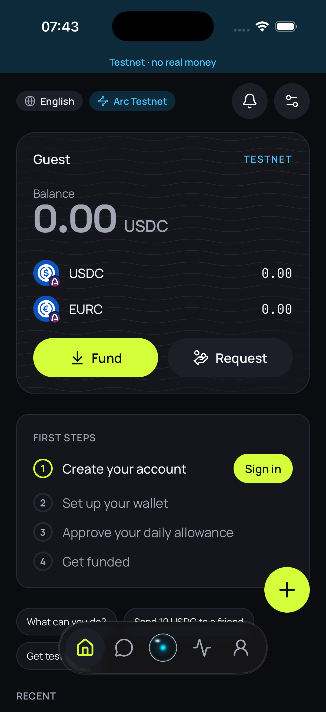
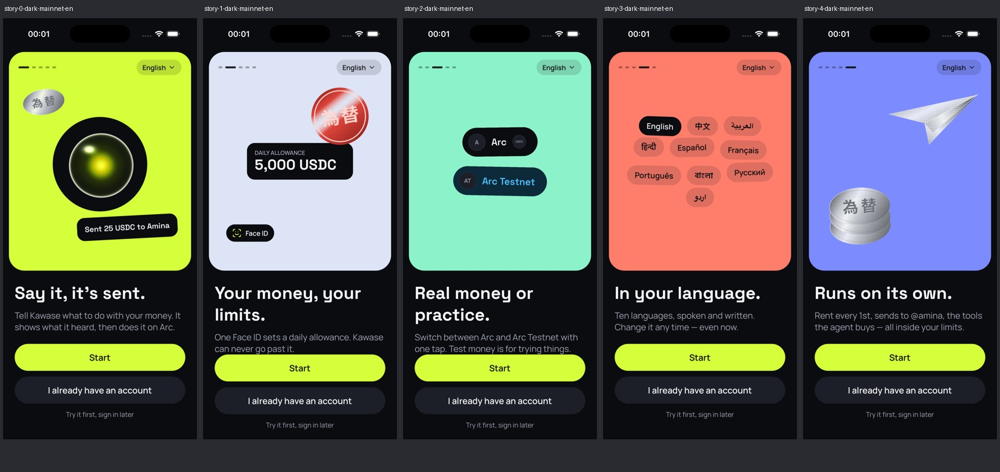
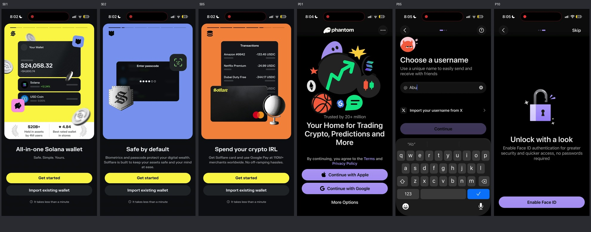

# Kawase mobile: strict UX, design, and motion review

Date: 2026-10-01. Reviewer: Codex. Review baseline: main at 6934c1b, plus the working tree visible during this review. The Stage 5 addendum was inspected through approximately 06:57 UTC. Stage 5 work was already in progress; those unrelated changes were preserved.

**Verdict: rework before mobile UX acceptance.** The approved Lime on Ink direction is worth retaining. The current experience has recognizable materials and components, but the journey is not yet coherent enough, the onboarding art does too little explanatory work, and several account/authority/recovery states are wrong. Passing a component lint check and rendering a storyboard do not establish a good mobile experience.

This is a review and an implementation handoff. No application source was changed. Proposed compositions and copy below are recommendations, not newly approved product policy.

## 1. Scope, authority, and evidence

### What this review covers

Reviewed the current mobile screen and shared-component implementations, session/authentication/setup routing, funding and activity surfaces, chat cards, settings/limits, overlays, motion code, design decisions, revamp plan, stage status, product flow inventory, and the imported reference study. Compared the onboarding boards with relevant reference frames and inspected the M01, M06, M16, and M18 motion strips.

During the review, the implementation agent also wrote new untracked send/contact components. Those drafts received an additional source review in section 9a. They were not part of the earlier simulator capture or static-check counts and were not yet connected to a complete routed journey when inspected. Findings describe this point-in-time snapshot; ongoing work can supersede them with evidence.

The reference corpus contains **three recordings: Solflare, Phantom, and Fomo**. The user described the inspirations conversationally as two; all three sources present in the repository were considered. Their role is to inform hierarchy, interaction, material, and motion, not to supply Kawase's financial or authentication policy.

Current authority:

- [DESIGN.md](/Users/abu/dev/hackathon/tamion/DESIGN.md): Lime on Ink, one primary action, real marks, language access, network distinction, motion grammar.
- [D33–D35](/Users/abu/dev/hackathon/tamion/context/08-product-research/DECISIONS-FROM-ABU.md:40): the current wallet/allowance model and revamp decisions.
- [Revamp plan](/Users/abu/dev/hackathon/tamion/plan/design/REVAMP-PLAN.md) and [current build status](/Users/abu/dev/hackathon/tamion/plan/STATUS.md:9): what is implemented and what is still staged.
- [Reference study](/Users/abu/dev/hackathon/tamion/docs/design/reference-study-2026-09-30/README.md), especially [motion evidence and limits](/Users/abu/dev/hackathon/tamion/docs/design/reference-study-2026-09-30/04-motion-and-assets.md).

The old Koe direction and imported Senryo context are historical. Do not use either to override current Kawase decisions. Do not reintroduce wallet PINs, Telegram/Discord, or a confirmation prompt for every payment inside an approved allowance.

### Evidence levels used below

| Label | Meaning |
|---|---|
| Observed | A fresh runtime capture or direct response was obtained in this review. |
| Code-confirmed | The relevant control flow or layout is present in current source; the scenario was not exercised end to end. |
| Risk | Source suggests a failure or layout problem that still needs device verification. |
| Design recommendation | A reasoned critique or proposed composition; not a measured functional defect. |

Fresh evidence:

- [Current iOS guest home](review-evidence/2026-10-01/current-ios.png): a read-only screenshot of the running Kawase iPhone 17 Pro simulator, captured 2026-10-01. This establishes the visible home hierarchy, not that every route has been tested.
- [Web welcome response](review-evidence/2026-10-01/welcome-response.html): the local Metro server returned HTTP 500 for /welcome with “Cannot read properties of undefined (reading 'RuntimeEffect')”.
- [Story board comparison](review-evidence/2026-10-01/board-story.jpg) and [reference onboarding comparison](review-evidence/2026-10-01/reference-onboarding.jpg): contact sheets made from existing repository images. The story board is historical fixture evidence, not a fresh capture of live onboarding. Some historical marks and layouts have subsequently changed in source.

Computer-use verification was attempted. Native capture failed with ScreenCaptureKit error 3811; the in-app browser also timed out on navigation/focus operations. Consequently, I did **not** complete an interactive onboarding walkthrough, authenticate, grant authority, revoke authority, send money, or verify motion by playing the current app. Android, real-device biometrics, VoiceOver/TalkBack, large text, and current web rendering remain unverified.

Static verification completed:

- 21st review of mobile source: 85 files, zero errors, two autofocus warnings, ten informational findings.
- 21st review of native UI source: 59 files, zero errors, three warnings, twenty informational findings.
- Token contrast script passed its defined text pairs across four themes and five story fields.

Those checks are useful hygiene. They do not test workflow correctness, glass/opacity contrast in context, focus order, dynamic type, interruptions, or whether an illustration communicates the product. Autofocus is not automatically wrong; the reference username/code steps make it useful when focus is managed deliberately.

## 2. What should stay

Keep the ink surfaces, restrained lime, silver illustration family, authentic entity marks, distinct sky testnet layer, language-first architecture, shared onboarding bar, keyboard-aware handle footer, optional handle, per-step setup retries, real funding/activity backends, persistent authority receipt, and typed access to the agent. These are useful foundations.

Keep the product's approved interaction model: one deliberate device approval for authority; no extra payment prompt inside that authority; accurate review and device approval above it. The review calls for clarity about what authority is being granted and truthful outcomes, not more friction everywhere.

The central design problem is that these ingredients are assembled as separate features. The agent needs to design the user's changing situation: exploring, creating an account, waiting for setup, deciding whether to allow autonomous spending, funding, doing something useful, and recovering when something fails.

## 3. Priority findings

P1 blocks acceptance of the affected account/authority/network journey. P2 is a substantial UX or craft problem that should be addressed in the next mobile revision. P3 is a refinement. No P0 exploit or actual loss of funds was demonstrated.

| ID | Priority | Finding | Evidence |
|---|---|---|---|
| R01 | P1 | Network/server errors clear the saved session. | Code-confirmed |
| R02 | P1 | The decoded authority scope is revealed after approval rather than before it. | Code-confirmed |
| R03 | P1 | An unavailable device check still proceeds to sign the allowance. | Code-confirmed |
| R04 | P1 | Activity and historical chat cards can be shown under the wrong network context. | Code-confirmed |
| R05 | P1 | A failed revoke leaves the hold control permanently committed. | Code-confirmed |
| R06 | P1 for web preview | Welcome currently returns HTTP 500. | Observed; cause inferred from imports |
| R07 | P2 | Returning/optional onboarding and interrupted-action routing are not state-aware. | Code-confirmed |
| R08 | P2 | Authentication/setup errors are misclassified or have no recoverable presentation. | Code-confirmed |
| R09 | P2 | Guest home has competing primary actions and prioritizes empty finance UI over orientation. | Observed + design recommendation |
| R10 | P2 | Story content borrows reference aesthetics without explaining the product sufficiently. | Board/source + design recommendation |
| R11 | P2 | Carousel wrap, timer, and gesture ownership are incomplete. | Code-confirmed |
| R12 | P2 | Current capability claims run ahead of working mobile journeys. | Code/status-confirmed |
| R13 | P2 | Modal semantics, accessible navigation, and small-screen/RTL behavior need correction and proof. | Code-confirmed + risks |
| R14 | P2 | Chat/history refresh and scrolling do not respect the user's reading/recovery context. | Code-confirmed |
| R15 | P2 | Trust/consent continuity and transaction provenance are incomplete. | Code-confirmed + staged gaps |
| R16 | P2/P3 | Motion substitutions and overlay geometry are not yet faithful or well coordinated. | Code-confirmed + runtime risks |
| R17 | P2; inherits R03's P1 | New send/contact drafts need correct amount rendering, request ownership, recovery, and provenance. | Code-confirmed; unfinished drafts |

### R01 — A connection problem becomes a logout

**Evidence:** [session-provider.tsx:44](/Users/abu/dev/hackathon/tamion/apps/mobile/src/session/session-provider.tsx:44). Every failure of the user read reaches a catch that deletes the saved token and clears the user. The catch is described as an expired/revoked session, but it also receives connectivity and server failures.

**User impact:** opening or refreshing the app on an unreliable connection can send a known user into the first-launch experience. A money app appearing to have forgotten an account is a trust failure, not merely an error message problem.

**Required fix:** distinguish confirmed invalid/revoked authentication from timeout, offline, and server failures. Preserve the account and last-known data with a clearly stale/read-only state when identity cannot be refreshed. Provide Retry and a deliberate sign-out route. Do not create a replacement guest as a side effect of a transient read failure.

**Acceptance:** reopen a known account offline; fail the user endpoint with a 5xx; then restore connectivity. Identity, network, drafts, and navigation survive. A genuinely revoked session still receives an explicit reauthentication journey.

### R02 — Show the authority before asking for approval

**Evidence:** [setup-screen.tsx:80](/Users/abu/dev/hackathon/tamion/apps/mobile/src/screens/setup-screen.tsx:80) displays a config-derived daily amount. The primer at line 142 shows general allowance copy. [use-wallet-setup.ts:89](/Users/abu/dev/hackathon/tamion/apps/mobile/src/wallet/use-wallet-setup.ts:89) invokes the device check, then requests the allowance payload, signs it, submits it, and returns the request receipt. The detailed authority receipt is rendered on the completion screen at [setup-screen.tsx:163](/Users/abu/dev/hackathon/tamion/apps/mobile/src/screens/setup-screen.tsx:163).

**User impact:** the person sees what Kawase can and cannot do only after they have approved it. A generic daily number cannot explain token, network, period/reset, expiry, recipient restrictions, or the effective upper bound. This is a mismatch between the promised trust layer and the decision moment. It is not evidence that a malicious payload was signed.

**Required fix:** obtain the proposed payload and decoded scope first; render a concise authority summary immediately above the approval CTA; bind approval to that exact scope and refresh/re-review if it changes or expires. Use the authoritative accepted result for completion. Identify unknown caveats before approval rather than presenting a reassuring completion followed by uncertainty.

The readable summary should answer: which asset and network, how much per period, when it resets/expires, who can receive funds if restricted, what the agent can do, what it cannot do, and how to turn it off. Keep advanced detail expandable. If the current grant has no expiry, state that accurately; do not invent a reassuring expiry. Any amount-editing policy remains a product decision.

**Acceptance:** compare displayed scope to the actual signed payload and accepted receipt; vary network/limit/expiry; cancel approval; fail submission; delay confirmation. No authority is presented as active before its status is known. Within-allowance sends retain D33's no-prompt behavior.

### R03 — “Unavailable” is not an approved device check

**Evidence:** [biometric.ts:12](/Users/abu/dev/hackathon/tamion/apps/mobile/src/wallet/biometric.ts:12) returns none on web or a device without an enrolled authentication facility. Line 29 then returns unavailable. [use-wallet-setup.ts:92](/Users/abu/dev/hackathon/tamion/apps/mobile/src/wallet/use-wallet-setup.ts:92) stops only for cancelled, so unavailable still proceeds to signing. Android facial recognition is also labelled fingerprint in the capability mapping. The primer title is fixed Face ID wording even when the detected facility differs.

**Required fix:** model approved, cancelled, failed, and unavailable distinctly. Only an explicitly approved, supported authentication path should continue under the current device-approval promise. Use the approved passkey/device alternative where available, or show a recoverable unsupported/setup-needed state. Do not silently lower the requirement and do not invent a wallet PIN. Match primer, button, and system prompt wording to the real capability.

**Acceptance:** Face ID, Touch ID, Android facial/fingerprint, device passcode fallback, cancellation, lockout, no enrolled facility, and web. Capture actual-device evidence; simulator success alone is insufficient.

The new [use-send.ts:103](/Users/abu/dev/hackathon/tamion/apps/mobile/src/send/use-send.ts:103) draft repeats this issue for above-allowance transfers: it stops on cancelled but accepts unavailable. Fix the shared contract and every caller before integrating that path.

### R04 — Network context must travel with money data

**Evidence:** [use-activity.ts:15](/Users/abu/dev/hackathon/tamion/apps/mobile/src/wallet/use-activity.ts:15) retains existing items while the next network fetch runs, preserves them on failure, and has no response sequencing/cancellation. State is not keyed by user/wallet/network. [tool-cards.tsx:490](/Users/abu/dev/hackathon/tamion/apps/mobile/src/chat/tool-cards.tsx:490) renders stored wallet/activity tool output with the user's current active network, rather than the output's original network.

**User impact:** switching networks can temporarily place old transactions under a new header; a late response can replace newer data. A past chat card can acquire a different network context when reopened. Colour cannot repair incorrect provenance.

**Required fix:** scope cached results by user, wallet, and network; discard superseded responses; never display a mismatched dataset as belonging to the current network. Persist the network with tool results and render historical cards from that snapshot. Clearly distinguish historical data from a fresh read.

**Acceptance:** switch during a slow fetch, switch twice quickly, fail the second fetch, switch while a receipt is open, and reopen an old chat after changing networks. Amounts, entity marks, explorer links, receipts, and network labels remain mutually consistent.

### R05 — A failed revoke cannot leave a success-looking control

**Evidence:** [limits-screen.tsx:69](/Users/abu/dev/hackathon/tamion/apps/mobile/src/screens/limits-screen.tsx:69) catches revoke failures and clears revoking. Its hold control has resetAfter set to zero at line 137. [hold-to-confirm.tsx:48](/Users/abu/dev/hackathon/tamion/packages/ui-native/src/components/hold-to-confirm.tsx:48) sets committed before the async operation succeeds; zero prevents reset. The committed face contains a checkmark.

**User impact:** a rejected signature or failed request leaves authority active and the button committed/disabled with a check and “Revoking…” state. The user loses the retry route at exactly the moment they are trying to remove authority.

**Required fix:** separate deliberate hold completion from transaction success. Make the operation state controlled: idle, holding, awaiting signature, pending, confirmed, failed, and unknown outcome. A known failure restores a usable action. An unknown outcome offers reconciliation before another submission. Show a success check only after the required authoritative result.

**Acceptance:** release early, cancel signing, fail before submission, fail after submission, delay confirmation, reopen the page, and retry a known failure. Exactly one operation is submitted per deliberate attempt; the existing hold duration and accessible deliberate gesture remain intact.

### R06 — Welcome must render on the supported web surface

**Evidence:** fresh local /welcome request returned HTTP 500 with RuntimeEffect undefined. [story-panels.tsx:17](/Users/abu/dev/hackathon/tamion/apps/mobile/src/onboarding/story-panels.tsx:17) imports the native VoiceOrb directly; [voice-orb.tsx:18](/Users/abu/dev/hackathon/tamion/packages/ui-native/src/components/voice-orb.tsx:18) evaluates Skia RuntimeEffect at module scope. The app already has a platform orb wrapper. This import is the likely cause; a complete stack-level diagnosis was not performed.

**Required fix:** use the platform-safe orb entry point and a valid static/prerender fallback before a browser renderer is ready. Verify direct URL loads as well as client navigation. Web sign-in is separately recorded as unfinished; a working story preview should not depend on signing in.

**Acceptance:** /welcome returns successfully, loads directly, survives refresh, and supports language/theme changes without native-only initialization. Test the actual web build, not only a native board.

### R07 — Optional onboarding and interrupted actions need durable state

**Evidence:** [sign-in-provider.tsx:27](/Users/abu/dev/hackathon/tamion/apps/mobile/src/sign-in/sign-in-provider.tsx:27) always routes to handle. [handle-screen.tsx:76](/Users/abu/dev/hackathon/tamion/apps/mobile/src/screens/handle-screen.tsx:76) skips only when a handle exists; skipping records no durable asked/skipped state. Funding opens sign-in for a guest, but sign-in has no continuation context.

**Required fix:** route from account state and the initiating intent. A returning account that declined a handle should not be asked again as compulsory onboarding. A guest who began funding, viewing a receive address, or drafting an agent action should return to that relevant destination after required setup. Persist the optional-step decision and retain the guest draft when upgrading the account.

Handle completion may remain where approved, but make its optionality unmistakable and do not make it a recurring tax on sign-in. Closing authentication should return to the same parent context. Restoring a draft must never submit it automatically.

**Acceptance:** new user, returning with handle, returning without handle after Skip, partial setup, revoked allowance, account change, and guest-to-account action continuation. Back/close paths are predictable and no duplicate onboarding pages accumulate.

### R08 — Errors need to say what actually failed

**Evidence:** [sign-in-sheet.tsx:64](/Users/abu/dev/hackathon/tamion/apps/mobile/src/sign-in/sign-in-sheet.tsx:64) wraps both authentication and wallet provisioning in one failure handler. Verification passes invalid-code copy for the entire sequence at line 96: a wallet failure after successful authentication can therefore be reported as a bad code. Closing the sheet resets local state without invalidating in-flight completions. Resend has no visible cooldown/rate-limit presentation. [use-wallet-status.ts:14](/Users/abu/dev/hackathon/tamion/apps/mobile/src/wallet/use-wallet-status.ts:14) has no catch/error state; an initial read failure leaves setup without a retryable loaded state. [story-screen.tsx:53](/Users/abu/dev/hackathon/tamion/apps/mobile/src/screens/story-screen.tsx:53) has finally but no user-facing failure path for starting a guest.

**Required fix:** separate identity success, wallet provisioning, network setup, and authority approval. Show specific wrong/expired code, offline, rate-limited, provisioning-failed, and setup-pending states. Keep successful identity established while retrying provisioning. Guard stale completions after close/account change. Add an initial-load retry state distinct from retrying a failed setup operation.

**Acceptance:** valid code followed by wallet failure never says invalid code; retry does not create duplicates; close during a request does not unexpectedly navigate later; expired/resend/rate-limit flows preserve the address; guest-start failure remains on a usable screen with Retry.

## 4. Onboarding and home: the design rework

### R09 — Guest home has no clear next best action

This is the current running guest screen. The zero balance card occupies most of the first view, repeats zero asset rows, and offers Fund. The checklist offers Sign in. A bright floating plus adds another strong invitation; the orb is another entry point. The first view gives more space to empty financial scaffolding than to the question “What can I use Kawase for right now?”

**Evidence:** [home-screen.tsx:108](/Users/abu/dev/hackathon/tamion/apps/mobile/src/screens/home-screen.tsx:108), actions at line 219, checklist at line 234, and [first-steps.tsx:54](/Users/abu/dev/hackathon/tamion/packages/ui-native/src/components/first-steps.tsx:54). The source includes bottom scroll clearance, so this review does not claim the last rows are permanently inaccessible. The initial viewport does put the dock over the introductory chip area.

**Direction:** design home by state rather than showing the same dashboard with different zeros.

| State | Dominant content | One main action | Supporting content |
|---|---|---|---|
| Guest | A short explanation and useful typed exploration | Try a supported task; create account when needed | Quiet sign-in, explicit preview/testnet context |
| Account, wallet setup incomplete | One next required step with understandable progress | Finish the relevant setup step | Retry, later/exit, account identity |
| Wallet ready, no allowance | Wallet and the optional benefit of enabling the agent | State-appropriate funding or allowance action | Clear statement of what works without allowance |
| Empty testnet wallet | Small balance summary plus a guided practice opportunity | Get test funds | Real receive address and funding alternatives |
| Funded, first task incomplete | The next useful action | First supported practice task | Last receipt, authority summary |
| Returning account | Useful balances and recent activity | The relevant money action | Compact authority/status cues |

Avoid treating optional authority as a required condition for simply owning or receiving into a wallet. The current four-step checklist places approval before funding; copy and ordering should distinguish required setup from optional agent activation.

Reserve lime for the chosen action. The plus can use a quiet glass treatment while retaining an obvious hit target. Reduce the guest balance card; do not erase real account balances to accommodate marketing. Make per-asset balances explicit; do not call an unconverted USDC number an aggregate of USDC and EURC.

**Acceptance:** a first-time user can identify the next useful action in five seconds; only one non-navigation action dominates; the main action and supporting explanation fit in the first viewport on a small device; scrolling and the dock never obstruct the final actionable content.

### R10 — The onboarding art needs a job beyond decoration

The board has a consistent palette and recognizable objects. That is a foundation, not a complete story. The orb/coin composition does not explain how a request becomes an action. The allowance panel presents a large number and a seal but does not teach the boundary. Two network pills do little with a large field. Language chips demonstrate choice but not the agent understanding a request. The paper plane/coins do not explain automations or a marketplace.

Solflare S01/S02/S05 connect expressive art to wallet, safety, and spending concepts. Phantom P05/P10 place input and device approval in a concrete progression. The transferable principle is **a visual answer to the user's question**, not just silver objects on coloured backgrounds.

Retain the approved five-panel shell for this revision. Recommended briefs:

| Panel | Question answered | Composition | Example copy direction |
|---|---|---|---|
| Request | What do I do here? | One readable example request; amount, asset, recipient, and network become structured fields. The orb supports the event. | “Tell Kawase what you need.” Explain typing today and voice availability truthfully. |
| Boundaries | What can it do without asking? | One compact scope card: amount/period, asset, network; a visible boundary and an above-limit review state. Seal is secondary. | “Choose what the agent can spend.” Approval copy must follow actual grant policy. |
| Practice | Can I learn without risking real funds? | A labelled testnet task and result; clear testnet versus real-money distinction. | “Practice with test money.” Explain the one-tap network switch. |
| Language | Will it understand me? | One short request in the selected language paired with the same structured interpretation; selectable language control remains accessible. | “Use your own language.” Promise only verified language capabilities. |
| Next step | What should I try first? | A single supported first task with a real interface preview; future automations/tools clearly distinguished if retained. | “Try your first task.” End with an obvious entry into the useful experience. |

These are illustrative narrative briefs, not fake completed transactions. Label example amounts and testnet clearly. The current story uses a testnet limit while rendering its brand art in mainnet mode; an unqualified number must not look like a universal mainnet promise.

Each panel needs one focal object/event, one supporting layer, and enough remaining space for readable copy. Increase the scale and purpose of the hero; avoid filling every blank area with more chips or floating coins. Static reduced-motion art must still explain the same event.

There are three possible scopes: cosmetic polishing alone would leave the core problems; refining the existing five-panel journey is recommended; reducing to a shorter story is an optional product change requiring agreement. The agent should complete the recommended revision without treating an unapproved new visual direction as necessary.

### R11 — The carousel is not interruptible enough

**Evidence:** [story-screen.tsx:45](/Users/abu/dev/hackathon/tamion/apps/mobile/src/screens/story-screen.tsx:45) auto-advances with modulo five. [story-shell.tsx:93](/Users/abu/dev/hackathon/tamion/packages/ui-native/src/components/story-shell.tsx:93) animates directly to the indexed horizontal position. The fifth-to-first transition therefore travels backward across four panel widths. Gesture begin does not explicitly cancel the current timing, and the timer is not paused for dragging, lost focus, backgrounding, or screen-reader use. The pan has no cancellation/finalization settlement path.

**Required fix:** prefer stopping on the final panel; if looping is retained, use a true adjacent transition. Separate rare decorative story travel from responsive finger-driven paging. Cancel the active animation when the user takes control, settle interrupted/cancelled gestures, and restart dwell after interaction. Pause timers and decorative work while covered, unfocused, backgrounded, or being read through assistive technology. Provide accessible manual navigation.

The roughly 900ms M01 adaptation is not inherently wrong for a rare illustrative story. The defect is applying the same travel model to a four-page wrap and a direct swipe without adequate interruption handling. Do not “fix” this by making every animation universally fast.

**Acceptance:** advance through the final panel; grab mid-transition; reverse direction; open language/sign-in; background and return; enable reduced motion; use a screen reader. No four-panel sweep, timer/gesture fight, stranded offset, or unsolicited page change while reading.

### R12 — Promise only what a user can actually do

**Evidence:** [English story copy](/Users/abu/dev/hackathon/tamion/packages/i18n/src/catalog/en.ts:241) promises voice-led sending and broader future features. [voice-overlay.tsx](/Users/abu/dev/hackathon/tamion/apps/mobile/src/overlay/voice-overlay.tsx) presents a coming state; [overlay-host.tsx:45](/Users/abu/dev/hackathon/tamion/apps/mobile/src/overlay/overlay-host.tsx:45) has coming toasts for Send/Request; home Request also opens a toast. [Build status](/Users/abu/dev/hackathon/tamion/plan/STATUS.md:12) explicitly identifies send, voice, automations, and other journeys as later work.

**Required fix:** derive available entry points and copy from actual capabilities. A roadmap story can communicate ambition if labelled as such. A primary action labelled Send should lead into a usable send journey when that feature ships. Until then, orient users toward working typed tasks, real funding, balances, activity, and authority review. Do not put a future feature behind an ordinary action and reveal its unavailability only after tapping.

**Acceptance:** every primary CTA has a complete path or an explicit pre-tap availability state. The story, fan, home suggestions, settings, chat capability cards, and actual backend agree. The first-steps journey reaches a useful action and its result once Stage 5 is ready; it does not declare onboarding complete merely because the wallet is funded.

## 5. Screen-by-screen guidance

Use these briefs alongside the findings, not as a request to add every future feature immediately.

| Surface | Required design correction | What the agent must show |
|---|---|---|
| Story | A coherent request → boundary → practice narrative; persistent footer; labelled examples; manual reading control. | All five panels, first/final transition, long translations, reduced-motion stills. |
| Sign-in methods | Clear method hierarchy, authentic provider marks, concise privacy/recovery context, parent preserved. | Email, provider cancellation, unavailable platform, nested language selection, keyboard open. |
| Email code | Explain destination, change email, expiry/resend state, precise failure classification. | Autofill/paste, wrong/expired code, rate limit, provisioning failure after valid code. |
| Optional handle | Explain why a handle helps; visible Skip; keep validation slot stable. Consider avoiding forced keyboard before a screen-reader heading is read. | Taken/reserved/network error, keyboard, Skip remembered, edit from Settings. |
| Automatic setup | Human-readable progress, what the app is doing and whether funds are needed; initial-read failure separated from operation failure. | Slow/failing stages, independent retry, app restart, leaving and resuming. |
| Allowance primer | Replace seal-dominant generic reassurance with the actual proposed scope and an accurate device approval CTA. | Full preapproval summary, expanded restrictions, cancel/unavailable/expired payload. |
| Completion | Receipt is the main content; art supports it; clear next task; keep language access. | Confirmed versus pending/unknown result, terms access, long scope, persistent receipt. |
| Guest home | Orientation and one useful entry point, smaller zero state, quiet secondary actions. | Small-device first viewport, guest draft → auth → continuation. |
| Account home | State-aware next step; distinguish missing, loading, stale, and zero balances. | Empty/funded/offline/degraded states; scroll/header/dock geometry in both directions. |
| Funding | Method → details → pending credit → confirmed credit. Preserve the parent when returning from receive/sign-in. | Claim pending/failed/cooldown, external deposit delay, network switch, back/close. |
| Receive | Clear asset/network/address hierarchy, copy/share feedback, wrong-network guidance. QR motion cannot impair scanning. | Static scannable code, actual copy payload, share cancellation, small/large text. |
| Activity/receipt | Status and provenance before decoration; readable amount, recipient, network, time, fees when known, persistent outcome. | Filter-specific empties, stale refresh, pagination policy, pending/unknown/reconciled states when intents land. |
| Chat | Stable reading position; typed-first discovery; money cards preserve their original context. | Streaming while reading history, reconnect, failed tool, network switch, restored thread/draft. |
| Quick-action fan | Available actions only; useful order; consistent origin, blur, dismissal, and focus. | Open/select/cancel/reopen quickly from each supported parent. |
| Voice | Honest availability now; later, show heard text, interpretation, listening/thinking/speaking/errors, and immediate typed exit. | Permission denied, interruption, no speech, correction, above-allowance device approval. |
| Settings/limits | Working control and recovery paths first; avoid a settings hub dominated by disabled roadmap rows. | Language/theme/network, account sessions/help where supported, full revoke recovery. |

## 6. Accessibility, layout, and recovery perspectives currently missing

### R13 — Accessibility is part of the interaction, not a final checkbox

**Code-confirmed:** [blur-overlay.tsx:58](/Users/abu/dev/hackathon/tamion/packages/ui-native/src/components/blur-overlay.tsx:58) is a visual absolute layer without explicit modal accessibility/focus management. The overlay provider has no Android hardware-back handling. The fan retains closed controls in the tree without explicit accessibility hiding. [glass-dock.tsx:89](/Users/abu/dev/hackathon/tamion/packages/ui-native/src/components/glass-dock.tsx:89) calls every slot a tab, including the voice action. Story progress pressables lack individual labels/roles; their expanded hit areas overlap closely spaced tiny segments. The hold hint is hardcoded English.

**Fix:** hide inactive overlay content and the inaccessible underlay appropriately; move focus into the opened interaction and restore it to the trigger on close; handle hardware back before navigating the underlying route; announce action buttons as actions and navigation tabs as tabs. Give story navigation meaningful accessible labels and non-overlapping interaction targets or explicit Next/Previous alternatives. Localize hints and status announcements. Do not make every background decorative object an accessibility element. React Native documents the relevant [modal/hiding/focus accessibility mechanisms](https://reactnative.dev/docs/accessibility).

**Layout risks, not runtime-proven failures:**

- Story canvas takes half the window height while the remaining copy is clipped, not scrollable: [story-shell.tsx:176](/Users/abu/dev/hackathon/tamion/packages/ui-native/src/components/story-shell.tsx:176). Small screens, large text, and longer translations can lose copy.
- The primer uses a centered fixed composition without a scroll container; receive also has substantial fixed artwork and footer controls. Verify both with large text and compact heights.
- Shared [sheet.tsx](/Users/abu/dev/hackathon/tamion/packages/ui-native/src/components/sheet.tsx) uses BottomSheetView; tall content needs an explicit accessible scrolling/maximum-height strategy and keyboard verification.
- Home puts two leading pills and two 44pt trailing buttons around a compact centered header. The collapse threshold is fixed, rather than derived from the moving card. Verify crowded scripts and small widths; do not place the compact balance over the pills.
- [glass-dock.tsx:53](/Users/abu/dev/hackathon/tamion/packages/ui-native/src/components/glass-dock.tsx:53) places the bubble at logical start but always translates it positively on X. Under mirrored slot order this should travel the opposite way. Verify all slots after changing to Arabic/Urdu; a static RTL board does not prove animated indicator placement.
- Small checklist actions use 36pt visual buttons; the balance copy target also needs sufficient touch area. Preserve compact visual sizing if desired, but provide at least the intended 44pt usable target without overlap.

**Acceptance:** VoiceOver and TalkBack traverse only the active surface; hardware Back closes an overlay; focus returns predictably; large text remains readable without hiding decisions; all RTL dock slots align; language changes while a sheet/keyboard is open preserve state; physical address/amount strings retain correct LTR interpretation.

Reanimated's [useReducedMotion documentation](https://docs.swmansion.com/react-native-reanimated/docs/device/useReducedMotion/) says the hook reports the setting at app start and does not rerender when the OS setting changes. If live changes are part of acceptance, subscribe to the platform accessibility change rather than assuming this hook covers that scenario.

### R14 — Respect reading position and distinguish “couldn't load” from “nothing exists”

**Evidence:** [conversation.tsx:107](/Users/abu/dev/hackathon/tamion/apps/mobile/src/chat/conversation.tsx:107) animates to the bottom on every content-size change. Streaming can repeatedly pull someone away from older messages. [chat-screen.tsx:48](/Users/abu/dev/hackathon/tamion/apps/mobile/src/screens/chat-screen.tsx:48) replaces a failed thread read with a new empty conversation; its thread-list catch returns an empty list, which the initial-load path interprets as no previous conversation.

**Fix:** follow the stream only while the person is already near the bottom; offer a new-message affordance otherwise. Preserve drafts and last-known conversation content through reconnect. Show history-read failure with Retry rather than implying no threads exist. Provide an intentional stop/cancel affordance for long responses as the agent flow develops. Do not add money-action retries until intent reconciliation makes them safe.

**Acceptance:** scroll up during streaming and remain there; reopen a stored thread offline; switch threads while a fetch is slow; reconnect and retry without losing drafts or duplicating tool actions.

### R15 — Trust continuity and provenance need real endings

**Consent and language:** completion removes the onboarding bar and its language pill at [setup-screen.tsx:127](/Users/abu/dev/hackathon/tamion/apps/mobile/src/screens/setup-screen.tsx:127), contrary to the current every-onboarding-screen rule. Terms are plain text at line 174; the record write is swallowed on failure at line 117. Not now and returning-account shortcuts can bypass this record path. Restore language access; provide actual terms/privacy destinations; define when versioned consent is required, durable, retryable, and recoverable. Keep this aligned with S25 and the upcoming trust stage. This is a product-recording/continuity finding, not a legal compliance determination.

**Activity provenance:** [activity.ts:92](/Users/abu/dev/hackathon/tamion/apps/api/src/wallet/activity.ts:92) can label an inbound transfer Circle faucet solely because it is near a claim timestamp. An unrelated incoming transfer in that window can inherit that identity. Use a verified claim transaction/counterparty link; otherwise show a neutral accurate sender description.

**Receipt state:** the current activity feed is explorer-derived; its confirmed receipt label is not proof of fake success. However, it is not yet a complete pending/unknown-intent timeline. When Stage 5 intents are connected, add submitted, pending, confirmed, reverted, and unknown/reconciled endings as first-class states. Avoid prematurely applying a confirmed-only receipt component to a submitted intent.

**Other gaps:** filtered activity empties should name the active filter; refresh failures with retained rows need a stale/error banner; disclose a truncated history or implement pagination. Account recovery, lost-device/session control, fee reserve, pending reconciliation, first useful task, and an effective exit path remain separate acceptance gates. The source records several of these as later stages; do not mark them implemented on the strength of screenshots.

**Acceptance:** read/open terms in any onboarding language; fail the consent record; skip/return through setup; inspect an unrelated inbound transfer near a faucet claim; reopen every money outcome after restart. No misleading provider identity, lost outcome, or silent claim of a completed trust layer.

## 7. Motion review and concrete direction

**Motion verdict: block acceptance until interruption, geometry, and outcome behavior are demonstrated.** This verdict does not assert that every current animation looks bad in live playback; that playback was unavailable. The source already exposes several wrong or incomplete contracts.

| Motion | Before / current evidence | After / required direction | Why |
|---|---|---|---|
| Story M01 | Every index change takes the same travel; final-to-first sweeps four widths. | Adjacent travel or stop at the end; finger-driven settle is responsive and interruptible; copy follows the selected event; footer stays fixed. | Spatial continuity and reading control. |
| Fan M06 | Native stagger exists, but blur exit and action exit have different lifetimes. Closed controls stay mounted. | Open from the plus; Send leads when available; small overshoot; coordinate reverse exit, blur, mounting, and focus. | A fan is one interaction, not four unrelated spring toys. |
| Voice overlay | Travel uses page midpoint arithmetic; the actual orb is in a stacked layout. Dock orb remains behind the overlay. | Measure trigger and destination centers; transfer visual ownership once; restore exact parent, scroll, keyboard, and focus. | The orb should visibly originate in the dock, without a jump or duplicate. |
| Dock M09/M10 | Fixed index-based X translation; compact header fades at a fixed threshold. | Mirror offset correctly; measure header/card transition geometry; keep compact content clear of controls. | Navigation and balance context should remain spatially reliable. |
| Completion M18 | Two different flag paths crossfade: [flag.tsx:53](/Users/abu/dev/hackathon/tamion/packages/ui-native/src/components/art/flag.tsx:53). | A continuous fabric/specular deformation once, or a beautiful still if unavailable; receipt is the focus. | Crossfading two silhouettes is an adaptation, not the observed metallic cloth motion. |
| Hold | Animated width drives the fill; commitment immediately shows a check, independent of transaction result. | Transform/clip-based progress where practical; deliberate hold and pending/result states are separate; hold duration unchanged by reduced motion. | Stable performance and truthful feedback. |
| Chat stream | Repeated animated scroll on every content growth. | Follow only at bottom; stop following when the user reads history; small new-message cue. | User control matters more than movement. |
| Ambient art/orb | Multiple story panels remain mounted with loops; app-state/focus pausing is absent. | Animate visible art only; suspend while hidden/backgrounded; static fallback for reduced motion. | Battery/frame-budget risk; no FPS or battery measurement was made here. |

Additional source: [quick-action-fan.tsx](/Users/abu/dev/hackathon/tamion/packages/ui-native/src/components/quick-action-fan.tsx), [voice-overlay.tsx](/Users/abu/dev/hackathon/tamion/apps/mobile/src/overlay/voice-overlay.tsx), [motion tokens](/Users/abu/dev/hackathon/tamion/packages/config/src/motion.ts). Exit timings can currently outlive the blur host's close interval. Verify the whole sequence, including rapid reopen, instead of judging one settled frame.

Suggested tuning ranges for ordinary actions are approximately 150–250ms; decorative story travel can retain its slower approved treatment. These are implementation starting points, not recovered competitor easing values. Use one coherent family per interaction; avoid applying the same spring/float to every object. Haptics should reinforce actual success/commitment and not fire merely because an animation finishes.

For each motion, record initial state → trigger → first movement → midpoint → settling → exit → restored parent. Compare this sequence to the relevant reference clip and record the adaptation honestly. M16's nested funding interaction means back returns to the preserved parent method/context, not merely that a child sheet can open. M18 means continuous cloth/light movement, not any waving-looking SVG. Exact original spring/easing, audio, haptics, and authentication mechanisms remain unknown in the recordings.

## 8. Missing perspectives and scope boundaries

| Perspective | Needed in the current mobile slice | Later feature gate |
|---|---|---|
| First-time explorer | Clear working entry, optional account creation, retained draft. | Full first-send tutorial once send is usable. |
| Returning user | State-aware routing, skip remembered, no repeated provisioning. | Cross-device recovery and richer session management. |
| Interrupted/offline user | Preserve identity/data; truthful stale state; retry correct step. | Durable intent reconciliation and notification recovery. |
| User granting authority | Exact proposed scope before device approval; cancel/off path. | Risk dial, scoped automations, richer allowance editing. |
| User revoking/leaving | Revoke failure recovery and authoritative status. | Complete export/sweep/exit kit. |
| Multilingual/RTL user | Actual long-script layouts, localized errors/hints, working RTL motion. | Verified end-to-end voice understanding in each claimed language. |
| Assistive-tech user | Accessible modal/navigation/focus, readable large text, typed equivalence. | Every new trading/automation interaction must extend this. |
| Android/low-capability device | Platform-safe capability copy, Back behavior, blur/static fallback, unsupported-auth state. | Real-device performance and voice permission acceptance. |
| Web visitor/judge | Welcome renders; honest platform availability; useful readable preview. | Actual web authentication and full money journey. |
| User with pending/uncertain money | Do not represent submission as completion; persistent result access. | Full state integration when executor/intents ship. |

Do not demand trading, marketplace, automations, production mainnet, or full voice as fixes to the current Stage 3/4 slice. Equally, do not use their planned status to claim that the complete mobile product is already designed, tested, or accepted. The current account and authority defects are actionable now; future transaction states should be designed now and validated when their backend exists.

Apple's [onboarding guidance](https://developer.apple.com/design/human-interface-guidelines/onboarding) supports introducing the app efficiently and helping people learn through use. Here the useful implication is a short, comprehensible story connected to a working first task; no need to add more explanatory slides to compensate for a weak journey.

## 9. Documentation and fidelity claims to correct

1. Reconcile [USER-FLOWS-INDEX.md](/Users/abu/dev/hackathon/tamion/context/08-product-research/USER-FLOWS-INDEX.md) and [FEATURE-INVENTORY.md](/Users/abu/dev/hackathon/tamion/context/08-product-research/FEATURE-INVENTORY.md) with current decisions. They retain older confirmation/channel assumptions, including Telegram examples. D31/D33 take precedence. A future agent must not resurrect superseded policy from a flow example.
2. Correct any design overview that calls Koe current. [docs/design/README.md](/Users/abu/dev/hackathon/tamion/docs/design/README.md) and historical handoff text need explicit archival labels where old direction remains.
3. In the revamp ledger, distinguish referenced, designed, implemented, runtime-verified, and accepted. Mark changed visual/motion compositions Adapted. Use Exact only for the particular observed property that was actually compared; do not infer complete fidelity from a matching ID.
4. Replace “all states/flows covered” with links to actual state captures and scenario results. Existing boards contain fixture data and do not prove authentication, transactions, interruption, accessibility, or runtime layout.
5. Update the status when these findings are resolved. Keep unresolved device/web/Android/voice/mainnet gates visible. Green static review and a successful testnet backend spike cannot substitute for mobile journey evidence.

The study is an evidence library. Its screen, motion, component, and identity IDs are handles for inspection, not decorations to attach to component comments.

## 9a. R17 — Additional review of the new Stage 5 drafts

The new send review, blocker, status, controller, add-contact sheet, keypad, and chat send card were being written while this report was assembled. Their direction improves on the earlier shell: the amount leads, warnings have words, recipient provenance is considered, the network is taken from the intent, and pending/unknown/failure endings are explicitly represented. Keep those improvements. The chat card was wired into tool-card rendering during the review; its runtime behavior, routed screen, and executed transfer were not verified.

Corrections before accepting this slice:

1. **Render the currency once.** [send-review.tsx:98](/Users/abu/dev/hackathon/tamion/apps/mobile/src/send/send-review.tsx:98) calls formatAmount with its default symbol enabled, renders that result, and then renders the asset symbol again at line 113. The accessibility label also appends the symbol again. [format.ts:37](/Users/abu/dev/hackathon/tamion/packages/money/src/format.ts:37) confirms the default already appends it. Use figures without the symbol when a separate symbol is displayed, and announce one coherent amount. Verify long amounts, localized digits, EURC, compact chat cards, and large text.
2. **Fix the inherited device-approval bypass.** R03 now applies to the above-allowance send caller as well. This is a P1 condition for integrating that route, even though the rest of R17 concerns draft craft/recovery.
3. **Give refreshes an owner.** [use-send.ts:52](/Users/abu/dev/hackathon/tamion/apps/mobile/src/send/use-send.ts:52) unconditionally applies a response; polling can overlap with edits or replacement of the intent. An old response can overwrite a newer version or a newly selected intent. Check intent ID and monotonically fresh version/state, serialize or cancel superseded reads, and preserve terminal outcomes. A two-second interval alone is not a consistency strategy.
4. **Expose a lost connection while following money.** Initial/poll refresh errors are swallowed at lines 61 and 66. Approval errors otherwise collapse to a generic failure toast. After a potentially accepted submission, retain the intent and show checking/reconnect/reconcile rather than implying nothing happened or presenting a blind repeat. No duplicate payment was demonstrated; the backend has its own concurrency/idempotency work, which still needs end-to-end acceptance.
5. **Make resolve-and-resume resilient.** [send-blocker.tsx:51](/Users/abu/dev/hackathon/tamion/apps/mobile/src/send/send-blocker.tsx:51) clears the network-switch continuation before creating the replacement draft and silently catches creation failure. Keep a retryable continuation with the original request intact. Exercise sign-in, wallet setup, funding, contact creation, and network change as child flows; verify revalidation on return and no automatic submission.
6. **Keep address provenance truthful.** [add-contact-sheet.tsx:65](/Users/abu/dev/hackathon/tamion/apps/mobile/src/contacts/add-contact-sheet.tsx:65) marks a paste as pasted, but subsequent field edits at line 129 do not update that source. A different manually entered address can retain the pasted/scanned source. Distinguish actual acquisition, user-reported origin, and verified identity. A chip saying pasted/scanned is not evidence that the destination belongs to the intended person.
7. **Allow meaningful recipient inspection.** The review card shows a truncated secondary address/handle. Provide a way to inspect the full resolved address, original query, and any lookalike warning before an approval requiring review. Test long recipient names and provenance chips without squeezing the identity into unreadable ellipses. Do not add an unsolicited confirmation to an ordinary within-allowance agent action merely to compensate for this layout.
8. **Tie celebratory departure to the actual ending.** [send-status.tsx:86](/Users/abu/dev/hackathon/tamion/apps/mobile/src/send/send-status.tsx:86) assigns the plane flight as an exit animation for the moving view; that view also leaves for unknown/failure transitions. Reserve the expressive departure for confirmed success. Checking/reverted/not-sent should transition to their own calm, clear explanations. This is a source-level motion contract finding, not observed current playback.
9. **Complete localization and integration evidence.** New English catalog entries were present; corresponding new-language coverage and routes were still being built. Do not count the existing ten catalogs as verification of these new strings. Re-run the appropriate static checks after integration and record small-screen, RTL, accessibility, and transaction-state evidence.
10. **Resolve the extra chat approval against D33.** [send-card.tsx:69](/Users/abu/dev/hackathon/tamion/apps/mobile/src/chat/send-card.tsx:69) waits for a Send tap for every ready proposal, including the allowance route, while the meter says it sends without asking. A manual amount-entry screen naturally needs an initiating Send action. An already explicit agent request inside an approved allowance should follow the approved no-prompt behavior unless a separately approved policy exception applies. Document the distinction and the exception; do not silently redefine D33 through implementation.
11. **Localize the entire numeric display consistently.** [keypad.tsx:43](/Users/abu/dev/hackathon/tamion/apps/mobile/src/send/keypad.tsx:43) localizes the whole digits but appends the canonical fractional digits unchanged. Arabic-style displays can therefore mix scripts within one amount. Choose a consistent display policy and preserve a separate canonical API value. Test decimal entry, trailing zeros, erase, Arabic/Urdu/Bengali digits, and the screen-reader announcement.
12. **Preserve provenance when saving from chat.** [send-card.tsx:57](/Users/abu/dev/hackathon/tamion/apps/mobile/src/chat/send-card.tsx:57) initializes every post-send contact with source pasted, regardless of how that address was actually obtained. Carry the recipient's actual source or an honest unknown/user-reported value instead.

Acceptance for this draft slice: one amount/symbol, correct approval facility, no stale response replacing a newer intent, explicit offline/checking state, recoverable child-flow return, truthful contact provenance, and success-specific motion. Then demonstrate the first useful send and reopen its authoritative outcome after restart.

## 10. Implementation order for the agent

### Pass 1 — Correct the trust and recovery contract

Resolve R01–R05 and the initial-load/auth failure parts of R08 first. Model errors and money/authority endings before polishing success animations. Keep current backend work isolated from unrelated UI changes. Add focused verification for session failure classification, network response races, and revoke retry/unknown outcome; these tests validate consequential behavior rather than mirroring render markup.

Apply the R17 draft corrections before wiring the new send/contact components into the accepted mobile journey; they should inherit the corrected shared trust/recovery contracts.

### Pass 2 — Make onboarding one coherent journey

Resolve R07, R09–R12. Retain the approved visual system, revise the five panel briefs, design state-based home, remember optional decisions, and carry the initiating intent through authentication/setup. Define the useful first action according to capabilities actually ready. Show revised compositions for guest, partial setup, no allowance, funded, and returning states.

### Pass 3 — Layout, accessibility, platform support, and motion

Resolve R06 and R13–R16. Verify small screens, large text, RTL, keyboard, focus, Android back, and web rendering. Coordinate whole transition lifetimes; pause hidden animation work; measure voice/dock origins. Use settled screenshots plus short recordings, not screenshots alone.

### Pass 4 — Evidence-based acceptance

Record the scenario matrix below and update the plan/fidelity ledger. A failed or unavailable gate stays failed/unverified. The agent's final handoff should list what changed, why, which scenarios passed, and which remain open, with paths to evidence.

## 11. Acceptance matrix

Capture evidence without exposing private account details. Use testnet for money rehearsals and obtain any separately required authorization for signing/live actions. Design and source review do not themselves authorize new financial transactions.

| Scenario | Required evidence / pass condition |
|---|---|
| Fresh install, English | Story understood; one main next step; guest exploration usable. |
| First panel language change | Immediate translation/direction; selected panel and intended action retained. |
| Arabic/Urdu journey | Correct text/amount/address direction, all dock slots, sheets, keyboard, errors. |
| Compact device + large text | Story copy, primer scope, receive details, CTAs readable/reachable; no clipped decisions. |
| Story interruption | Grab during travel, reverse, cancel gesture, last panel, background/return all settle correctly. |
| Auth cancellation | Parent preserved; no delayed surprise navigation. |
| Wrong/expired/rate-limited code | Correct message and recovery; address and draft preserved. |
| Valid auth + provisioning failure | Account remains established; retry wallet only; no invalid-code message. |
| Returning after Skip | Optional handle not demanded again; relevant destination restored. |
| Initial setup read failure | Explicit load error/Retry; no endless inferred running state. |
| Device approval matrix | Correct capability wording; unavailable/cancelled never silently treated as approved. |
| Allowance approval | Scope shown before approval equals signed/accepted scope; cancellation leaves it inactive. |
| Allowance submission uncertain | Persistent pending/unknown state; no premature success or blind resubmission. |
| Revoke failure and restart | Retryable known failure; unknown outcome reconciled; active/off status authoritative. |
| Offline account reopen | Token/identity/network preserved; clearly stale/read-only data; reconnect recovers. |
| Network race | Old requests cannot overwrite a new context or relabel historical cards. |
| Funding child → parent | Selected method, network, scroll, and input preserved; pending credit distinct from received. |
| QR and copy/share | Static code scans; copied data matches displayed network/address; share cancellation restores parent. |
| Activity and chat history | Filter-specific empty, stale read, failed history, old network card, and long history behave truthfully. |
| Streaming while reading | User remains in older messages; intentional return-to-bottom affordance. |
| Fan/voice rapid open-close | Stable origin/exit, no duplicate orb, no invisible focusable controls, parent restored. |
| VoiceOver/TalkBack + Back | Active surface only, meaningful roles/labels, focus restored; hardware Back closes overlay first. |
| Reduced motion | Equivalent information and static QR/art; no auto-reading interruption; hold duration preserved. |
| Web direct welcome | Successful response and rendered platform-safe story; refresh/theme/language work. |
| First useful money task | When Stage 5 lands: task → applicable policy path → real persistent outcome → reopen after restart. |

## 12. Agent handoff

Read this review alongside current DESIGN.md and D31/D33–D35. Preserve the approved Lime on Ink direction and working backend integrations. Do not begin with another palette change or a new pile of decorative assets.

Correct account preservation, preapproval scope, device approval handling, network provenance, and revoke recovery first. Then make onboarding and home state-aware, replace decorative-only story compositions with one understandable product event per panel, connect authentication back to the initiating action, and ensure copy reflects current capabilities. Complete accessibility, compact/large-text/RTL layouts, and interruptible coordinated motion. Record whole journeys and recovery paths before marking them accepted.

The desired result is a mobile experience a person can understand, control, trust, and recover from. Attractive screenshots are part of the evidence; they are not the acceptance criterion.
